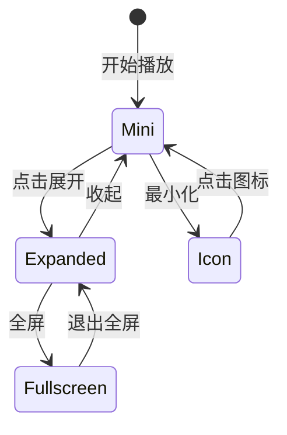

# FunHub — 产品规划与技术实施方案

> 项目名称：FunHub  
> 仓库名称：`dsh-funhub`  
> 产品类型：DSH（DeepSeek Harness）娱乐工作台插件  
> 规划版本：V1.0  
> 产品定位：轻量、模块化、可扩展的个人娱乐工作台  
> 核心板块：小说、漫画、图片、音乐、小游戏  
> 辅助板块：RSS  
> 数据策略：本地优先，支持 WebDAV 多设备同步

---

# 1. 项目概述

## 1.1 项目目标

FunHub 是一个运行在 DSH 中的娱乐工作台插件，整合小说阅读、漫画浏览、图片浏览、音乐播放、HTML5 小游戏和 RSS 订阅。

它不是传统的媒体聚合视频网站，也不是简单的资源导航页，而是一个可以直接使用的个人娱乐空间。

核心体验：

1. 打开 FunHub，首页即可看到不同娱乐板块。
2. 首页采用多行多列卡片布局，不采用传统纵向信息流。
3. 各板块卡片直接展示热门内容、最近阅读、收藏、历史记录等。
4. 点击具体内容即可快捷进入，不必每次进入完整频道。
5. 点击卡片标题进入对应的完整频道。
6. 音乐播放器在 FunHub 各个界面始终可访问。
7. 音乐播放器支持迷你、图标、展开歌词和全屏播放。
8. 用户可以自定义首页卡片的显示、位置和尺寸。
9. 用户数据优先保存在本地，并通过 WebDAV 同步到其他设备。
10. 支持导入不同类型的第三方资源源，逐步扩展内容生态。

## 1.2 产品设计原则

- **内容优先**：首页直接展示内容，不只是导航入口。
- **轻量化**：不做复杂的视频平台和社交系统。
- **模块化**：各个娱乐板块可以独立开发、测试和扩展。
- **本地优先**：没有云服务也能正常使用核心功能。
- **统一体验**：各个板块使用一致的视觉语言和交互方式。
- **可配置**：首页布局、资源源和播放器都可以自定义。
- **安全优先**：第三方资源脚本必须经过隔离，不能获得 DSH 宿主权限。

## 1.3 V1 功能范围

| 模块 | 优先级 | 主要功能 |
|---|---|---|
| 首页 Dashboard | P0 | 多列卡片、内容预览、布局配置 |
| 小说阅读 | P0 | 阅读书源、搜索、书架、阅读器 |
| 漫画 | P0 | 漫画源、搜索、章节、阅读器 |
| 图片广场 | P0 | 图片源、瀑布流、收藏、全屏浏览 |
| 音乐 | P0 | 洛雪音源、搜索、播放、歌词、歌单 |
| 全局播放器 | P0 | 迷你、图标、展开、全屏 |
| 小游戏 | P1 | HTML5 游戏、收藏、最近游玩、存档 |
| RSS | P1 | 订阅、文章列表、文章阅读 |
| 本地存储 | P0 | 收藏、历史、进度、配置 |
| WebDAV | P1 | 多设备数据同步 |
| 资源管理 | P0 | 各类型资源统一管理 |

## 1.4 暂不纳入 V1

为了控制开发范围，以下功能暂不纳入：

- 短剧聚合。
- Emby 媒体服务器。
- LibreTV 影视点播。
- IPTV 直播。
- 视频播放器。
- 复杂 AI 推荐算法。
- 用户社交、评论、关注。
- 通用第三方插件市场。
- 多用户云端服务。

未来可以作为独立模块扩展，但不应影响 V1 的核心体验。

---

# 2. 产品整体结构

## 2.1 主导航

建议主导航保持简单，只提供四个主要入口：

| 导航 | 功能 |
|---|---|
| 首页 | 各娱乐板块的 Dashboard |
| 发现 | 跨频道热门内容和推荐 |
| 收藏 | 统一收藏入口 |
| 设置 | 资源管理、布局、同步和偏好设置 |

小说、漫画、图片、音乐、小游戏和 RSS 作为独立频道，通过首页卡片或频道入口进入。

## 2.2 页面结构

```text
FunHub
│
├── Home
│   ├── 小说卡片
│   ├── 漫画卡片
│   ├── 图片卡片
│   ├── 音乐卡片
│   ├── 小游戏卡片
│   └── RSS 卡片
│
├── Discover
│   ├── 热门小说
│   ├── 热门漫画
│   ├── 精选图片
│   ├── 推荐音乐
│   └── 推荐小游戏
│
├── Reader
│   ├── 书架
│   ├── 书源搜索
│   ├── 书籍详情
│   ├── 阅读器
│   └── 阅读历史
│
├── Comic
│   ├── 漫画首页
│   ├── 漫画搜索
│   ├── 漫画详情
│   ├── 章节列表
│   └── 漫画阅读器
│
├── Gallery
│   ├── 图片瀑布流
│   ├── 图片详情
│   ├── 全屏浏览
│   └── 图片收藏
│
├── Music
│   ├── 音乐搜索
│   ├── 推荐歌曲
│   ├── 歌单
│   ├── 播放历史
│   └── 播放队列
│
├── Games
│   ├── 游戏首页
│   ├── 游戏分类
│   ├── 游戏搜索
│   ├── 游戏详情
│   ├── 游戏运行页面
│   └── 最近游玩
│
├── RSS
│   ├── 订阅列表
│   ├── 文章列表
│   └── 文章阅读
│
├── Favorites
│
└── Settings
    ├── 资源管理
    ├── 首页布局
    ├── 播放器设置
    ├── WebDAV 同步
    ├── 数据管理
    └── 关于
```

具体路由必须根据 DSH 当前版本提供的插件路由 API 实现，不得假设上述路由可以直接注册。

## 2.3 页面展示模式

采用 Hybrid 模式：

- 内嵌 DSH 页面：适合快速浏览、管理和轻量操作。
- 独立全屏页面：适合小说阅读、漫画阅读、图片浏览、音乐全屏和小游戏。

不同页面是否可以独立打开、如何保持状态，需要根据 DSH 当前插件机制验证。

---

# 3. 首页 Dashboard 设计

## 3.1 核心理念

首页采用：

**响应式多列卡片 Dashboard + 全局常驻音乐播放器。**

不采用传统纵向推荐信息流，也不做单纯的九宫格导航。

首页卡片是各频道的内容缩略窗口。

例如：

- 小说卡片展示最近阅读的书籍。
- 漫画卡片展示最近更新和追更记录。
- 图片卡片展示精选图片和收藏。
- 音乐卡片展示当前播放和最近播放。
- 小游戏卡片展示最近游玩和常用游戏。
- RSS 卡片展示最新订阅文章。

用户可以直接点击卡片中的内容，也可以进入完整频道。

## 3.2 首页布局示意

```text
┌─────────────────────────────────────────────────────────────┐
│  ✦ FunHub                                  搜索      设置    │
├─────────────────────────────────────────────────────────────┤
│                                                             │
│  ┌──────────────────────────┐  ┌──────────────────────────┐ │
│  │        小说阅读          │  │          漫画            │ │
│  │                          │  │                          │ │
│  │  [书籍] [书籍] [书籍]    │  │  [漫画] [漫画] [漫画]    │ │
│  │                          │  │                          │ │
│  │  最近阅读 / 我的书架     │  │  最近更新 / 追更记录     │ │
│  └──────────────────────────┘  └──────────────────────────┘ │
│                                                             │
│  ┌──────────────────────────┐  ┌──────────────────────────┐ │
│  │        图片广场          │  │          音乐            │ │
│  │                          │  │                          │ │
│  │  [图片] [图片] [图片]    │  │  [封面] 歌曲名称         │ │
│  │  [图片] [图片] [图片]    │  │         最近播放         │ │
│  └──────────────────────────┘  └──────────────────────────┘ │
│                                                             │
│  ┌──────────────────────────┐  ┌──────────────────────────┐ │
│  │        小游戏            │  │          RSS             │ │
│  │                          │  │                          │ │
│  │  [2048] [扫雷]           │  │  最新订阅文章            │ │
│  │  [数独] [方块]           │  │  最新订阅文章            │ │
│  └──────────────────────────┘  └──────────────────────────┘ │
│                                                             │
├─────────────────────────────────────────────────────────────┤
│  [首页]          [发现]          [收藏]          [设置]      │
├─────────────────────────────────────────────────────────────┤
│  [封面] 正在播放的歌曲              上一首  暂停  下一首  展开│
│  ━━━━━━━━━━━━━━━━━━━━━━━━━━━━━━━━━━━━━━━━━━━━━━━━━━━━━━━━ │
└─────────────────────────────────────────────────────────────┘
```

## 3.3 响应式布局

使用 CSS Grid 或 DSH 对应的布局能力实现。

| 屏幕宽度 | 建议列数 |
|---|---|
| 手机 | 2 列 |
| 小尺寸平板 | 2 列 |
| 大尺寸平板 | 2～3 列 |
| 普通桌面 | 3～4 列 |
| 超宽屏 | 4～5 列 |

断点根据 DSH 实际窗口尺寸调整。

## 3.4 卡片尺寸

支持不同尺寸：

- `1x1`：普通小卡片。
- `2x1`：横向宽卡片。
- `1x2`：纵向高卡片。
- `2x2`：大型内容卡片。

建议默认尺寸：

| 卡片 | 默认尺寸 |
|---|---|
| 小说 | 2x1 |
| 漫画 | 1x1 |
| 图片 | 1x1 |
| 音乐 | 1x1 |
| 小游戏 | 2x1 |
| RSS | 2x1 |

卡片尺寸只是默认配置，用户可以自定义。

## 3.5 卡片配置

每个卡片支持：

- 显示 / 隐藏。
- 调整位置。
- 调整宽度和高度。
- 设置展示数量。
- 选择数据来源。
- 选择展示模式。

小说卡片：

- 最近阅读。
- 我的书架。
- 最近加入。
- 热门小说。

漫画卡片：

- 最近更新。
- 最近阅读。
- 我的收藏。
- 热门漫画。

图片卡片：

- 精选图片。
- 最近浏览。
- 我的收藏。

音乐卡片：

- 当前播放。
- 最近播放。
- 我的歌单。
- 推荐歌曲。

小游戏卡片：

- 最近游玩。
- 我的收藏。
- 常用游戏。
- 推荐游戏。

RSS 卡片：

- 最新文章。
- 未读文章。
- 指定订阅分类。

## 3.6 卡片交互

| 点击位置 | 操作 |
|---|---|
| 卡片标题 | 进入完整频道 |
| 内容封面 | 打开内容详情 |
| 继续阅读 | 直接进入阅读器 |
| 最近播放 | 直接播放歌曲 |
| 游戏图标 | 直接启动游戏 |
| 查看全部 | 打开对应列表 |

首页必须具备快捷使用价值，不能只是频道入口集合。

---

# 4. 全局音乐播放器

音乐播放器是 FunHub 的核心特色之一。

它属于整个 App Shell，而不是某个具体频道。

## 4.1 播放器状态

支持四种 UI 状态：

| 状态 | 表现 | 功能 |
|---|---|---|
| Mini | 底部迷你播放器 | 歌曲信息、播放控制 |
| Icon | 悬浮小图标 | 最小化，不遮挡页面 |
| Expanded | 展开面板 | 封面、歌词、队列 |
| Fullscreen | 全屏播放页面 | 大封面、完整歌词 |

状态转换：



## 4.2 Mini 迷你播放器

显示：

- 歌曲封面。
- 歌曲名称。
- 歌手。
- 上一首。
- 播放 / 暂停。
- 下一首。
- 展开按钮。
- 播放进度。

固定在 FunHub 页面底部，具体位置适配 DSH 的页面结构。

## 4.3 Icon 悬浮图标

- 显示歌曲封面或音乐图标。
- 显示播放状态。
- 点击恢复 Mini。
- 可以拖动位置。
- 不遮挡重要操作区域。
- 位置可以记忆。

## 4.4 Expanded 展开面板

展示：

- 大尺寸封面。
- 歌曲名称和歌手。
- 播放进度。
- 播放控制。
- 歌词区域。
- 播放模式。
- 播放队列入口。
- 收藏按钮。
- 全屏按钮。

## 4.5 Fullscreen 全屏播放器

提供沉浸式播放体验：

- 专辑封面或背景。
- 当前歌词高亮。
- 歌词滚动。
- 上一首、播放 / 暂停、下一首。
- 播放模式。
- 播放队列。
- 收藏。
- 退出全屏。

## 4.6 播放器架构

播放器 UI 与音频播放引擎分离。

```text
GlobalMusicPlayer
│
├── PlayerManager
│   ├── AudioEngine
│   ├── QueueManager
│   ├── LyricsManager
│   └── PlaybackState
│
├── MiniPlayer
├── FloatingPlayerIcon
├── ExpandedPlayer
└── FullscreenPlayer
```

核心要求：

1. 音频播放实例全局单例。
2. 普通页面路由切换不销毁音频实例。
3. UI 状态变化不影响播放状态。
4. 收起播放器不等于暂停。
5. 切换歌曲正确释放旧音频资源。
6. 支持播放错误处理和重试。
7. 处理浏览器自动播放限制。
8. 适配 DSH 页面生命周期。

如果内嵌页面与独立页面运行在不同 WebView 或进程中，不能假设音频实例天然共享。

必须优先验证 DSH 是否提供 Host 级后台服务、持久页面或统一音频宿主能力。

## 4.7 音乐数据模型

```ts
interface Track {
  id: string
  sourceId: string
  sourceTrackId: string

  title: string
  artist?: string
  album?: string
  cover?: string

  duration?: number
  audioUrl?: string
  lyric?: string

  metadata?: Record<string, unknown>
}

interface PlaybackState {
  currentTrackId?: string
  position: number
  duration?: number

  status: 'playing' | 'paused' | 'stopped'

  mode: 'sequence' | 'loop' | 'single' | 'shuffle'
}

interface Playlist {
  id: string
  name: string
  trackIds: string[]
  createdAt: number
  updatedAt: number
}
```

临时音频 URL 不能作为长期同步数据。

同步歌曲 ID、来源 ID、播放位置和歌单信息；实际播放时重新向音源获取有效 URL。

---

# 5. 小说阅读模块

## 5.1 功能

- 阅读书源管理。
- 书源导入和导出。
- 书源测试。
- 书籍搜索。
- 书籍详情。
- 章节列表。
- 章节正文。
- 书架管理。
- 阅读历史。
- 阅读进度。
- 书签。
- 阅读设置。
- 章节缓存。

## 5.2 小说首页

展示：

1. 最近阅读。
2. 我的书架。
3. 最近加入。
4. 热门书籍。
5. 书源搜索入口。

## 5.3 阅读器

支持：

- 上一章、下一章。
- 自动翻页（可选）。
- 字体大小。
- 行间距。
- 页面边距。
- 字体选择。
- 背景主题。
- 亮色 / 暗色 / 护眼主题。
- 阅读进度。
- 书签。
- 章节缓存。

阅读器应优先保证长时间阅读的舒适性。

## 5.4 书源适配

参考「阅读」App 的书源 JSON 格式。

提供：

- 阅读书源 JSON 导入。
- 书源格式校验。
- 书源能力检测。
- 书源启停。
- 搜索规则测试。
- 书源版本管理。

书源脚本和规则是不可信外部输入，不能直接在 DSH Host 权限环境执行。

优先支持声明式规则；确实需要 JavaScript 规则时，使用隔离执行环境。

---

# 6. 漫画模块

## 6.1 功能

- 漫画源管理。
- 漫画搜索。
- 分类浏览。
- 漫画详情。
- 章节列表。
- 漫画阅读器。
- 最近阅读。
- 收藏。
- 更新提醒（可选）。

## 6.2 漫画首页

展示：

- 热门漫画。
- 最近更新。
- 最近阅读。
- 我的收藏。
- 分类入口。

## 6.3 漫画阅读器

支持：

- 单页模式。
- 双页模式（可选）。
- 从右向左翻页。
- 从左向右翻页。
- 上下滚动模式。
- 图片预加载。
- 章节切换。
- 阅读进度保存。
- 全屏阅读。

## 6.4 漫画源适配

```ts
interface ComicAdapter {
  initialize(): Promise<void>

  search(keyword: string): Promise<ComicItem[]>

  getDetail(id: string): Promise<ComicDetail>

  getChapters(id: string): Promise<ComicChapter[]>

  getChapterContent(
    chapterId: string
  ): Promise<ComicPage[]>

  dispose(): Promise<void>
}
```

不同漫画源的章节结构和图片规则可能不同，不能假设所有漫画源使用同一种数据结构。

---

# 7. 图片广场

## 7.1 功能

- 图片源管理。
- 图片搜索。
- 分类浏览。
- 图片瀑布流。
- 图片详情。
- 全屏图片浏览。
- 收藏。
- 最近浏览。
- 图片缓存。

## 7.2 图片首页

展示：

- 精选图片。
- 热门图片。
- 最近浏览。
- 我的收藏。

## 7.3 图片浏览体验

建议采用瀑布流布局。

支持：

- 图片自适应尺寸。
- 点击查看大图。
- 左右切换。
- 键盘方向键。
- 收藏。
- 图片信息。
- 来源信息。
- 版权信息。

## 7.4 图片来源

优先使用提供公开 API 且授权规则清晰的平台。

建议初始支持：

| 来源 | 类型 | 说明 |
|---|---|---|
| Pexels | 图片 API | 摄影、人物、时尚、风景 |
| Unsplash | 图片 API | 摄影、人物、生活方式、风景 |
| 本地图片 | 本地资源 | 用户自行导入 |
| 自定义 API | 扩展 | 用户提供合法 API |

建议图片分类：

- 人像摄影。
- 时尚摄影。
- 风景。
- 建筑。
- 自然。
- 动物。
- 生活方式。
- 艺术设计。

图片搜索应提供适龄内容过滤，避免导入不适宜内容。

第三方图片应遵守平台 API 使用、署名和链接要求。

保存图片时尽可能保留：

- 图片来源。
- 作者。
- 原始页面。
- 授权信息。
- 图片 ID。

---

# 8. 音乐模块

## 8.1 功能

- 音源管理。
- 音源导入。
- 音源测试。
- 歌曲搜索。
- 歌曲详情。
- 歌词。
- 封面。
- 歌单。
- 最近播放。
- 收藏。
- 播放队列。

## 8.2 音源兼容

优先研究洛雪音乐 LX Music 自定义源格式。

目标是兼容常见音源能力：

- 搜索歌曲。
- 获取歌曲播放地址。
- 获取歌词。
- 获取封面。
- 获取歌曲详情。

不默认假设所有洛雪音源脚本都兼容。

导入时执行接口检测，并显示实际支持的能力。

## 8.3 音源脚本安全

洛雪音源可能包含 JavaScript 脚本。

必须隔离执行：

- 禁止访问宿主文件系统。
- 限制网络请求范围。
- 限制执行时间。
- 限制内存和输出大小。
- 禁止任意动态模块加载。
- 不向脚本暴露 DSH 内部 API。
- 不允许脚本直接读取用户凭证。
- 记录脚本错误和执行日志。

未经审核的第三方音源不能自动安装或自动运行。

---

# 9. 小游戏模块

小游戏是 FunHub 的第五个核心娱乐板块。

定位为轻量 HTML5 小游戏集合，不做大型游戏分发平台。

## 9.1 功能范围

- 游戏列表。
- 游戏分类。
- 游戏搜索。
- 游戏详情。
- 游戏收藏。
- 最近游玩。
- 游戏启动。
- 游戏退出。
- 成绩记录。
- 本地存档。
- 游戏资源管理。

## 9.2 第一批内置游戏

优先支持：

| 游戏 | 类型 | 功能 |
|---|---|---|
| 2048 | 数字益智 | 分数、最高分、继续游戏 |
| 扫雷 | 逻辑益智 | 难度、计时、成绩 |
| 数独 | 数字益智 | 难度、笔记、提示 |
| 俄罗斯方块 | 经典休闲 | 方向控制、速度、分数 |

后续可以增加：

- 贪吃蛇。
- 记忆翻牌。
- 华容道。
- 经典弹球。
- 井字棋。
- 连连看。

V1 优先完成前四款游戏。

## 9.3 游戏首页

游戏频道展示：

- 推荐游戏。
- 最近游玩。
- 我的收藏。
- 游戏分类。

首页 Dashboard 的小游戏卡片展示：

- 最近游玩的游戏。
- 常用游戏快捷入口。
- 推荐游戏。

点击具体游戏可以直接启动。

## 9.4 游戏详情

游戏详情包含：

- 游戏名称。
- 游戏封面。
- 游戏简介。
- 操作方式。
- 历史最高分。
- 最近游玩时间。
- 开始游戏按钮。
- 收藏按钮。

## 9.5 游戏运行页面

建议采用独立游戏页面或全屏容器。

运行界面提供：

- 返回。
- 暂停 / 继续。
- 重新开始。
- 游戏说明。
- 分数和成绩。
- 游戏设置。

游戏退出时，根据游戏类型保存状态。

## 9.6 游戏架构

```text
Games
│
├── Game Library
│   ├── Game List
│   ├── Categories
│   └── Favorites
│
├── Game Manager
│   ├── Launch
│   ├── Save State
│   └── Game History
│
└── Game Container
    └── Sandboxed iframe
        ├── 2048
        ├── Minesweeper
        ├── Sudoku
        └── Falling Blocks
```

## 9.7 游戏安全

第三方 HTML5 游戏使用受限 iframe sandbox。

要求：

- 游戏不能直接访问 DSH Host API。
- 通过受控 `postMessage` 通信。
- 校验消息来源和消息结构。
- 禁止访问其他游戏数据。
- 限制外部网络请求。
- 游戏不能直接操作 FunHub 主页面。
- 游戏退出时清理运行资源。
- 自研游戏和第三方游戏使用不同的信任级别。

自研小游戏优先使用原生 HTML/CSS/JavaScript，不必为了几个简单游戏引入大型游戏引擎。

## 9.8 游戏数据结构

```ts
interface GameItem {
  id: string
  name: string
  description?: string
  category: string

  entry: string
  cover?: string

  source: 'builtin' | 'custom'
  enabled: boolean
}

interface GameRecord {
  gameId: string

  bestScore?: number
  lastScore?: number

  playCount: number
  lastPlayedAt?: number

  savedState?: Record<string, unknown>
}
```

第三方游戏只能通过受控接口保存其允许的数据，不能直接写入 FunHub 数据库。

---

# 10. RSS 模块

## 10.1 功能

- RSS / Atom 订阅。
- 添加订阅。
- 删除订阅。
- 分类管理。
- 定时刷新。
- 未读状态。
- 文章收藏。
- 文章阅读。
- 最近更新。

## 10.2 页面

RSS 首页展示：

- 最新更新。
- 未读文章。
- 订阅分类。
- 最近收藏。

## 10.3 数据结构

```ts
interface RSSFeed {
  id: string
  title: string
  url: string
  category?: string
  lastFetchedAt?: number
}

interface RSSArticle {
  id: string
  feedId: string
  title: string
  link: string
  summary?: string
  publishedAt?: number
  isRead: boolean
}
```

RSS 内容需要过滤不安全 HTML，外链使用安全导航策略。

---

# 11. 统一资源管理

资源管理是 FunHub 的基础设施。

不要为每个频道分别开发完全不同的资源管理页面。

统一设置资源管理中心。

## 11.1 资源分类

| 类型 | 管理对象 |
|---|---|
| 小说 | 阅读书源 |
| 漫画 | 漫画源 |
| 图片 | 图片 API |
| 音乐 | 洛雪音源 |
| RSS | RSS 订阅源 |
| 游戏 | HTML5 游戏包或游戏源 |

## 11.2 资源源管理功能

每个资源源支持：

- 添加。
- 编辑。
- 删除。
- 启用 / 禁用。
- 测试连接。
- 查看能力。
- 查看错误。
- 导入。
- 导出。
- 设置优先级。

## 11.3 统一资源模型

```ts
interface SourceConfig {
  id: string
  name: string

  type:
    | 'read'
    | 'comic'
    | 'image'
    | 'music'
    | 'rss'
    | 'html5'

  adapterId: string

  enabled: boolean

  config: Record<string, unknown>

  createdAt: number
  updatedAt: number
}
```

一个适配器可以对应多个资源源实例。

资源配置与资源适配器分离。

---

# 12. 统一适配器架构

## 12.1 核心接口

```ts
interface SourceAdapter {
  initialize(
    config: Record<string, unknown>
  ): Promise<void>

  getCapabilities(): SourceCapabilities

  testConnection(): Promise<SourceHealth>

  dispose(): Promise<void>
}

interface SourceCapabilities {
  search: boolean
  detail: boolean
  content: boolean
  categories: boolean
  favorites: boolean
}
```

具体媒体类型继承基础接口，增加自己的方法：

- BookAdapter。
- ComicAdapter。
- ImageAdapter。
- MusicAdapter。
- RSSAdapter。
- GameAdapter。

不强行将所有媒体源抽象成完全相同的数据结构。

## 12.2 统一内容模型

```ts
interface ContentItem {
  id: string
  sourceId: string

  type:
    | 'book'
    | 'comic'
    | 'image'
    | 'music'
    | 'article'
    | 'game'

  title: string
  cover?: string
  description?: string

  metadata?: Record<string, unknown>
}
```

每种媒体类型保留自己的扩展模型。

---

# 13. 技术架构

## 13.1 DSH 插件结构

FunHub 是 DSH 插件，不是普通 Agent Skill，也不是独立 Tauri 应用。

建议采用 Host + Client 双端结构。

```text
DSH
│
└── FunHub Plugin
    │
    ├── Host
    │   ├── 插件生命周期
    │   ├── 资源管理
    │   ├── 数据访问
    │   ├── 同步服务
    │   ├── 安全执行环境
    │   ├── 游戏管理
    │   └── Host API
    │
    └── Client
        ├── Home Dashboard
        ├── Reader
        ├── Comic Viewer
        ├── Gallery
        ├── Music
        ├── Global Player UI
        ├── Games
        ├── RSS
        └── Settings
```

Host 和 Client 之间通过 DSH 官方插件通信机制交互。

## 13.2 技术栈建议

| 层 | 建议 |
|---|---|
| 开发语言 | TypeScript |
| 插件生命周期 | Cordis（以 DSH 实际 API 为准） |
| UI | 复用 DSH 官方 UI 技术栈 |
| 状态管理 | 优先复用 DSH 已有方案 |
| 本地数据库 | SQLite 或 DSH 持久化 API |
| 图片缓存 | IndexedDB / Cache Storage |
| 音频播放 | Web Audio / HTMLAudioElement |
| 游戏容器 | HTML5 + sandbox iframe |
| 样式 | CSS Variables + 响应式布局 |
| 测试 | Vitest + Playwright |
| 同步 | WebDAV |

以上为技术建议，不代表 DSH 当前版本一定提供对应接口。

## 13.3 开发前必须验证 DSH API

开始实现前必须完成：

1. 插件加载机制。
2. manifest 格式。
3. Host 生命周期。
4. Client 页面挂载方式。
5. UI Slot。
6. 页面路由 API。
7. Host / Client 通信。
8. 本地持久化 API。
9. 页面全屏机制。
10. 页面卸载与后台任务生命周期。
11. 独立页面的状态保持。
12. 音频实例的生命周期。
13. iframe 和游戏容器的兼容性。

优先通过 DSH 官方文档和当前运行环境检查实际接口。

可使用已有的 `cordis_inspect_list`、`cordis_inspect_query` 等能力检查实际 Slot 和 Props。

禁止根据其他项目的 Cordis 示例直接猜测 DSH API。

---

# 14. 推荐项目目录

```text
dsh-funhub/
│
├── packages/
│   │
│   ├── plugin/
│   │   ├── src/
│   │   │   ├── host/
│   │   │   ├── client/
│   │   │   ├── routes/
│   │   │   └── manifest/
│   │   └── package.json
│   │
│   ├── core/
│   │   ├── models/
│   │   ├── adapters/
│   │   ├── events/
│   │   ├── services/
│   │   └── utils/
│   │
│   ├── adapters/
│   │   ├── read/
│   │   ├── comic/
│   │   ├── image/
│   │   ├── lx-music/
│   │   ├── rss/
│   │   └── html5/
│   │
│   ├── reader/
│   │
│   ├── comic-viewer/
│   │
│   ├── gallery/
│   │
│   ├── audio-player/
│   │   ├── engine/
│   │   ├── manager/
│   │   ├── lyrics/
│   │   ├── queue/
│   │   └── components/
│   │
│   ├── games/
│   │   ├── manager/
│   │   ├── container/
│   │   ├── protocol/
│   │   └── builtin/
│   │       ├── 2048/
│   │       ├── minesweeper/
│   │       ├── sudoku/
│   │       └── falling-blocks/
│   │
│   ├── storage/
│   │   ├── database/
│   │   ├── repositories/
│   │   └── migrations/
│   │
│   ├── sync/
│   │
│   └── ui/
│       ├── components/
│       ├── cards/
│       ├── layouts/
│       └── themes/
│
├── apps/
│   └── dev-harness/
│
├── docs/
│   ├── architecture.md
│   ├── source-adapters.md
│   ├── security.md
│   ├── games.md
│   └── development.md
│
├── tests/
│
├── pnpm-workspace.yaml
├── package.json
└── README.md
```

采用 pnpm workspace Monorepo。

`dev-harness` 只用于开发和测试，不作为正式产品入口。

---

# 15. 数据存储设计

## 15.1 本地优先

用户数据优先保存在本地。

建议使用关系型数据库保存结构化数据。

核心表：

| 表 | 作用 |
|---|---|
| sources | 资源源配置 |
| books | 书籍 |
| book_shelf | 书架 |
| reading_progress | 阅读进度 |
| reading_bookmarks | 阅读书签 |
| comics | 漫画 |
| comic_progress | 漫画阅读进度 |
| favorites | 统一收藏 |
| image_history | 图片浏览历史 |
| tracks | 歌曲元数据 |
| playlists | 歌单 |
| playlist_tracks | 歌单歌曲 |
| playback_history | 播放历史 |
| rss_feeds | RSS 订阅 |
| rss_articles | RSS 文章 |
| games | 游戏信息 |
| game_records | 游戏成绩和游玩记录 |
| game_saves | 游戏存档 |
| home_layout | 首页布局 |
| sync_metadata | 同步元数据 |

临时缓存不进入主要业务数据表。

## 15.2 阅读进度

```ts
interface ReadingProgress {
  bookId: string
  chapterId?: string

  chapterIndex: number
  position: number

  updatedAt: number
}
```

## 15.3 漫画进度

```ts
interface ComicProgress {
  comicId: string
  chapterId: string

  pageIndex: number
  updatedAt: number
}
```

## 15.4 统一收藏

```ts
interface Favorite {
  id: string

  itemType:
    | 'book'
    | 'comic'
    | 'image'
    | 'track'
    | 'article'
    | 'game'

  itemId: string
  sourceId: string

  createdAt: number
}
```

## 15.5 游戏存档

游戏存档需要按游戏隔离：

```ts
interface GameSave {
  id: string
  gameId: string

  state: Record<string, unknown>

  updatedAt: number
}
```

第三方游戏只能通过受控 API 访问自己的存档空间。

---

# 16. WebDAV 同步

## 16.1 同步范围

参与同步：

- 书架。
- 阅读进度。
- 阅读书签。
- 漫画收藏。
- 漫画阅读进度。
- 图片收藏。
- 音乐歌单。
- 播放历史。
- RSS 订阅。
- RSS 已读状态。
- 游戏收藏。
- 游戏成绩。
- 游戏存档。
- 首页布局。
- 用户偏好设置。

默认不参与同步：

- 图片缓存。
- 章节缓存。
- 音频缓存。
- 临时播放 URL。
- 临时搜索结果。
- 游戏运行缓存。
- 临时运行状态。

## 16.2 同步架构

```text
FunHub
  │
  ├── Local Database
  │
  ├── Sync Manager
  │     ├── Change Log
  │     ├── Conflict Resolver
  │     ├── Upload
  │     └── Download
  │
  └── WebDAV Server
```

## 16.3 冲突处理

| 数据 | 处理策略 |
|---|---|
| 阅读进度 | 以更新时间较新的有效记录为主 |
| 漫画进度 | 以更新时间较新的有效记录为主 |
| 书签 | 集合合并 |
| 收藏 | 集合合并 |
| 歌单 | 尽量合并歌曲，保留有效修改 |
| RSS 订阅 | 按稳定 ID 合并 |
| 游戏成绩 | 保留最高有效成绩 |
| 游戏存档 | 以更新时间较新的有效版本为主，必要时保留历史版本 |
| 首页布局 | 保留更新时间较新的配置 |

必须使用稳定 ID、更新时间和软删除标记。

删除操作使用 tombstone，避免旧设备重新上传已删除的数据。

## 16.4 WebDAV 安全

- 密码安全保存。
- 不在普通配置导出中保存密码。
- 支持连接测试。
- 支持同步开关。
- 支持手动同步。
- 支持自动同步。
- 支持同步日志。
- 支持冲突提示。
- 支持首次同步方向选择。

---

# 17. 安全设计

FunHub 会加载第三方资源规则和脚本，因此安全设计必须提前完成。

## 17.1 第三方脚本

阅读规则、洛雪音源脚本和部分漫画源可能包含 JavaScript。

不能直接在 DSH Host 权限环境执行。

必须考虑：

- 独立执行环境。
- 执行超时。
- 内存限制。
- 网络访问限制。
- 文件访问隔离。
- API 白名单。
- 日志与错误捕获。
- 脚本版本和来源记录。

## 17.2 游戏安全

- 第三方游戏使用受限 iframe。
- 通过受控消息协议通信。
- 不暴露宿主内部接口。
- 不共享不同游戏的存档空间。
- 限制网络访问。
- 退出时清理资源。
- 游戏内容加载失败时显示错误界面。

## 17.3 网络安全

资源源请求需要考虑：

- HTTPS 优先。
- URL 格式校验。
- 重定向检查。
- SSRF 防护。
- DNS 解析检查。
- 超时限制。
- 响应大小限制。
- 内容类型校验。

不能因为某个第三方资源源要求访问内网，就默认开放 Host 的全部网络访问能力。

## 17.4 HTML 内容安全

RSS 文章、书源返回的 HTML 和外部描述内容都属于不可信输入。

必须清理 HTML，限制脚本执行和危险 URL。

---

# 18. 资源来源建议

本章节提供资源生态参考，不在项目中内置未经确认授权的第三方资源地址。

资源管理器允许用户自行添加、测试、禁用和删除来源。

## 18.1 小说书源

| 名称 | 用途 | 地址 |
|---|---|---|
| 阅读（Legado） | 书源格式和规则参考 | https://github.com/gedoor/legado |
| 阅读书源资料库 | 研究社区书源格式 | https://legado.aoaostar.com |
| Open Library | 图书元数据与搜索 | https://openlibrary.org/developers/api |
| Project Gutenberg | 公版电子书 | https://www.gutenberg.org |

实施建议：

1. 优先兼容阅读 App 的书源 JSON 格式。
2. Open Library 用于元数据和搜索，不是完整电子书内容 API。
3. 公版书籍作为第一批演示数据。
4. 用户自行导入的书源经过格式检查和安全隔离。
5. 不内置来源不明或授权不清晰的书源集合。

## 18.2 漫画来源

| 名称 | 类型 | 地址 |
|---|---|---|
| MANGA Plus by SHUEISHA | 官方漫画平台 | https://mangaplus.shueisha.co.jp |
| WEBTOON | 官方漫画平台 | https://www.webtoons.com |
| 本地漫画文件 | 本地资源 | 用户自行导入 |

实施建议：

- 对官方平台提供合法入口和外部跳转。
- 不假设官方平台存在可自由调用的公开 API。
- 对用户提供的漫画源，提供统一适配器接口。
- 不绕过平台登录、付费和访问限制。
- 优先支持用户自有漫画文件和授权资源。

## 18.3 图片来源

| 名称 | 类型 | 地址 |
|---|---|---|
| Pexels | 摄影图片 API | https://www.pexels.com/api/ |
| Unsplash | 摄影图片 API | https://unsplash.com/documentation |
| 本地图片 | 本地相册 | 用户自行导入 |

建议图片分类：

- 人像摄影。
- 时尚摄影。
- 风景。
- 建筑。
- 自然。
- 动物。
- 生活方式。
- 艺术设计。

图片搜索提供适龄内容过滤，保存图片时保留来源、作者、原始页面和授权信息。

## 18.4 洛雪音乐源

| 名称 | 用途 | 地址 |
|---|---|---|
| LX Music | 官方网站 | https://www.lxmusic.cn |
| LX Music 文档 | 自定义源和使用说明 | https://www.lxmusic.cn/docs/ |

实施建议：

- 优先兼容洛雪自定义源格式。
- 支持本地 JS 文件导入。
- 支持用户主动确认的在线配置导入。
- 提供接口能力检测。
- 提供音源启停和错误日志。
- 不直接捆绑未经验证的第三方脚本。

洛雪音乐本身不保证提供可直接使用的音乐源，用户需要配置有合法使用权限的音源。

## 18.5 小游戏来源

第一版以自研游戏为主：

- 2048。
- 扫雷。
- 数独。
- 俄罗斯方块。

后续可以支持用户导入符合安全要求的 HTML5 游戏包。

第三方游戏需要明确来源、授权和运行权限，不能将任意网页直接作为可信游戏运行。

## 18.6 RSS 来源

支持任意合法 RSS / Atom 地址。

可使用：

- 用户自己的博客。
- 官方新闻网站 RSS。
- 开源项目更新 Feed。
- 技术博客 Feed。
- 公开资讯订阅。

RSS 不绑定固定内容供应商。

---

# 19. 主题与视觉设计

## 19.1 整体风格

建议：

- 深色模式作为默认主题。
- 浅色模式可选。
- 卡片采用柔和圆角。
- 内容封面优先。
- 少量强调色。
- 避免复杂渐变和过多装饰。
- 视觉重点放在书籍、漫画、图片和音乐封面。
- 游戏卡片可以使用更活泼的图标和色彩。

## 19.2 设计原则

1. 首页简洁但有内容。
2. 卡片是内容预览，不是单纯入口。
3. 阅读器尽量减少无关 UI。
4. 漫画阅读器优先保证图片显示体验。
5. 图片浏览器优先保证视觉空间。
6. 音乐播放器全局统一。
7. 游戏启动过程尽量直接。
8. 各频道共享基础组件和设计语言。

## 19.3 公共组件

```text
components/
├── AppShell
├── GlobalHeader
├── GlobalNavigation
├── GlobalMusicPlayer
├── DashboardGrid
├── DashboardCard
├── ContentCard
├── BookCard
├── ComicCard
├── ImageCard
├── TrackRow
├── GameCard
├── EmptyState
├── LoadingState
├── ErrorState
└── SourceSelector
```

---

# 20. 测试方案

## 20.1 单元测试

覆盖：

- 适配器接口。
- 数据模型。
- 阅读进度。
- 漫画进度。
- 播放队列。
- 歌词解析。
- 游戏存档。
- 游戏成绩。
- 数据库操作。
- 同步冲突处理。

## 20.2 集成测试

覆盖：

- 书源导入。
- 漫画源导入。
- 音乐源导入。
- RSS 订阅。
- 图片 API。
- 游戏启动。
- 游戏退出。
- 游戏存档。
- WebDAV 同步。
- 播放器路由切换。

## 20.3 E2E 测试

重点场景：

1. 打开 FunHub 首页。
2. 修改首页卡片布局。
3. 添加书源并搜索书籍。
4. 将书籍加入书架。
5. 阅读并保存进度。
6. 打开漫画并阅读。
7. 打开图片并收藏。
8. 搜索歌曲并播放。
9. 播放过程中切换到小说页面。
10. 播放过程中打开全屏歌词。
11. 收起播放器后继续播放。
12. 打开 2048 并完成一局。
13. 打开扫雷并切换难度。
14. 退出游戏后恢复允许保存的游戏状态。
15. 收藏小游戏并在首页快捷启动。
16. 重新打开 FunHub，恢复历史数据。
17. 两台设备进行 WebDAV 同步。

## 20.4 核心验收标准

- 播放器在普通页面切换后不会意外停止。
- 播放器收起不影响播放。
- 全屏退出后恢复原播放器状态。
- 首页布局可以保存和恢复。
- 卡片能直接打开具体内容。
- 阅读进度准确保存。
- 漫画进度准确保存。
- 音乐队列可以持久化。
- 游戏可以正常启动、暂停和退出。
- 游戏数据与其他游戏隔离。
- WebDAV 同步不会因删除操作产生数据复活。
- 第三方脚本不能访问宿主敏感权限。
- 页面在不同宽度下正常布局。

---

# 21. 开发阶段与里程碑

建议采用分阶段交付，每个阶段都能独立运行和测试。

## M0：DSH 插件技术验证

目标：确认 DSH 插件真实开发接口。

任务：

- 插件加载。
- manifest。
- Host / Client 通信。
- UI Slot。
- 路由。
- 持久化。
- 独立页面。
- 全屏机制。
- 音频生命周期验证。
- iframe 游戏容器验证。

交付物：

- 最小插件。
- DSH API 验证文档。
- 技术风险清单。

## M1：首页与基础设施

任务：

- App Shell。
- Dashboard Grid。
- 响应式卡片。
- 页面路由。
- 本地数据库。
- 资源管理框架。
- 主题系统。
- 首页布局配置。

交付物：

- 可运行的 FunHub 首页。
- 可配置卡片布局。
- 统一资源管理入口。

## M2：小说阅读

任务：

- 阅读书源导入。
- 书源管理。
- 搜索。
- 详情。
- 书架。
- 阅读器。
- 阅读进度。
- 书签。

交付物：

- 完整小说阅读模块。

## M3：漫画和图片

任务：

- 漫画源管理。
- 漫画阅读器。
- 图片 API。
- 图片瀑布流。
- 全屏图片浏览。
- 收藏和历史。

交付物：

- 完整漫画和图片模块。

## M4：音乐与全局播放器

任务：

- 洛雪音源适配。
- 音乐搜索。
- 音频引擎。
- 播放队列。
- Mini Player。
- Floating Icon。
- Expanded Player。
- Fullscreen Player。
- 歌词。

交付物：

- 全局音乐播放器。
- 音乐频道。

## M5：小游戏

任务：

- 游戏管理器。
- 游戏容器。
- 受限 iframe。
- 受控通信协议。
- 2048。
- 扫雷。
- 数独。
- 俄罗斯方块。
- 游戏成绩。
- 收藏和最近游玩。
- 存档机制。

交付物：

- 可运行的小游戏频道。
- 四款基础游戏。

## M6：RSS 和 WebDAV

任务：

- RSS 订阅。
- 文章阅读。
- 收藏统一化。
- WebDAV 连接。
- 增量同步。
- 冲突处理。
- 游戏存档同步。
- 数据迁移。

交付物：

- RSS 模块。
- 多设备同步。

## M7：完善和发布

任务：

- 全量测试。
- 性能优化。
- 安全检查。
- 文档完善。
- 插件打包。
- 版本发布。

交付物：

- FunHub V1.0。

---

# 22. 主要风险

| 风险 | 处理策略 |
|---|---|
| DSH 插件 API 与预想不同 | M0 先验证 |
| 阅读书源格式不一致 | 兼容性测试和能力检测 |
| 第三方 JS 脚本风险 | 隔离执行 |
| 漫画源不稳定 | 统一适配器和错误处理 |
| 音源失效 | 多源配置和健康检查 |
| 音频页面生命周期 | 提前验证宿主能力 |
| 图片 API 限流 | 缓存和请求节流 |
| 游戏 iframe 兼容性 | 先做独立原型 |
| 第三方游戏安全 | 沙箱和权限隔离 |
| WebDAV 冲突 | 增量日志和 tombstone |
| 图片缓存占用空间 | 容量上限和 LRU 清理 |
| 外部内容不安全 | HTML 清理和 URL 校验 |

---

# 23. V1 最终交付目标

V1 发布时应达到：

- DSH 插件可以正常安装和加载。
- 首页支持响应式多列卡片布局。
- 用户可以调整首页卡片位置和大小。
- 小说阅读功能完整。
- 漫画浏览和阅读功能完整。
- 图片浏览和收藏功能完整。
- 音乐搜索和播放功能完整。
- 音乐播放器在所有普通页面中保持可访问。
- 支持迷你、图标、展开和全屏播放器状态。
- 小游戏频道正常运行。
- 内置 2048、扫雷、数独和俄罗斯方块。
- 支持游戏收藏、历史和成绩记录。
- RSS 可以订阅和阅读。
- 数据本地持久化。
- WebDAV 可以同步核心用户数据。
- 外部资源源可以统一管理。
- 第三方脚本有基本安全隔离。

---

# 24. 给 AI 编码助手的实施要求

开发过程中必须遵守：

1. 先阅读 DSH 当前版本官方插件文档和现有插件示例。
2. 先完成 M0 技术验证，再开始大规模开发。
3. 不允许虚构 DSH API、路由 API、通信 API 或持久化 API。
4. 不要为了统一而强行抽象所有资源源。
5. 资源适配器必须可以独立测试。
6. 音频播放引擎必须与页面 UI 分离。
7. 不允许页面切换导致音频意外停止。
8. 不允许在 Host 权限环境直接运行第三方脚本。
9. 游戏必须在受限容器中运行。
10. 游戏存档必须按游戏隔离。
11. 所有用户数据模型都要考虑 WebDAV 同步。
12. 数据库结构需要迁移机制。
13. 所有外部网络请求需要超时、错误处理和安全校验。
14. 不要提前实现 V1 之外的影视、短剧、直播和媒体服务器功能。
15. 每个里程碑完成后先测试，再继续下一阶段。
16. 代码、文档和测试需要同步更新。
17. 遇到 DSH 能力不明确时，先验证，不要自行假设。

---

# 25. 项目总结

FunHub 的核心不是聚合尽可能多的资源，而是把日常娱乐体验做好。

它应该是一个打开就能使用的个人娱乐空间：

- 首页可以直接看到书籍、漫画、图片、音乐和小游戏。
- 内容卡片可以直接打开，不必层层跳转。
- 小说和漫画有舒适的阅读体验。
- 图片有沉浸式浏览体验。
- 音乐播放器始终陪伴在各个页面。
- 小游戏可以随时打开，玩完即可返回。
- RSS 方便查看自己订阅的内容。
- 用户的数据保存在本地，也可以通过 WebDAV 带到其他设备。

**最终产品定位：一个以小说、漫画、图片、音乐和小游戏为核心，拥有全局音乐播放器、个性化多列 Dashboard 和本地优先数据体系的 DSH 娱乐工作台。**